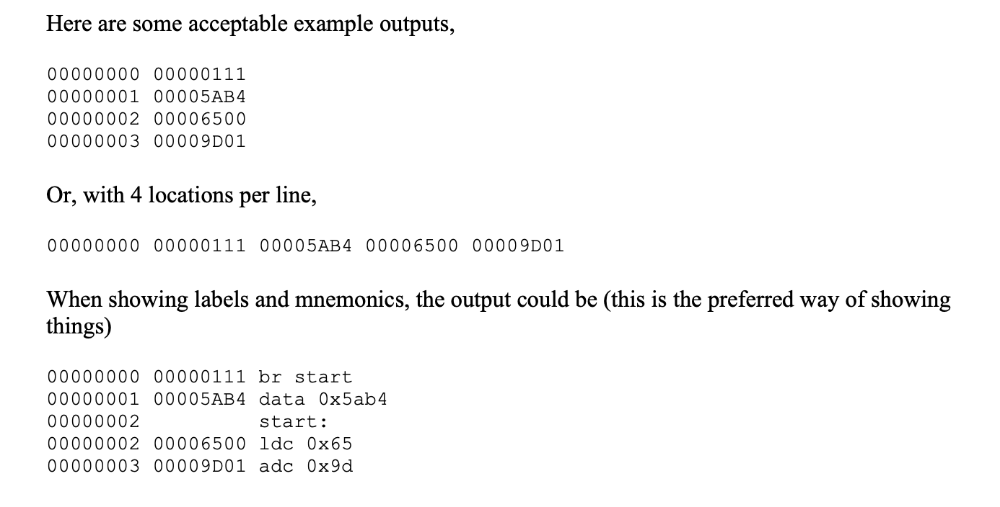

What is Assembly?
    Assembly language uses a mnemonic to represent each low-level machine operation or opcod

ISO C89
    Standard C
Assembler
    Converts assembly to machine code.
    Translation
    self assembler: runs on same computer it produces machine language code for
    cross assembler: runs of diff computer than the one it produces machine language for
    Single pass: generates opcode immediately in memory . but issue is it wants all the labels to be pre defined. If some new label comes, it is not able to resolve (soln: 2 pass).
    

**2 pass assembler**: if it encounters a label it doesnt recognise, it puts it in the symbol table along with the address where the undefined symbol's value has to be placed if encountered again. 
    First pass: for forward references and generate new opcodes and doing recursion (check ref 2) Symbol table is generated. 
    Second pass: symbolic opcode to machine understandable opcode. Program is read again and symbol table is used to get corresponding addresses associated with each label. Each instruction s converted to 32 bit machine code. 
Emulator
    program that acts like fake hardware. basically, it will keep track of registers, memory etc.
    runs the binary code given by assembler by activating physical CPU and memory.
    execution
EMU program

Processor
    basically the instruction set they gave us (MIPS is also an example).
    pseudo assembly code with registers memory and program counter. 
Program Counter/ Instruction Pointer
    register keeping track of where the processor is in a program (bookmark).
    holds memory address of next instruction that processor will execute.

Project Specs:

    "Hardware"
        4 registers- 32 bits (8 bits- opcode, 24 bits for operand)
            2 are stack
            1 PC
            1 Stack pointer
        operand is 2's complement (with sign)
    Assembler:
        Line based
        comments ';'
        blank lines are permitted
        white space at start are allowed
        label names are followed by a ':'
        will produce a listing file (human readable)
            address followed by zero or one 32 bit value (in hex)
            
            any of these are acceptable
        should issue error warning
To explore:
    Hash table to store symbol tables. 

References:
https://www.geeksforgeeks.org/compiler-design/introduction-of-assembler/
https://kshitij-taley19.medium.com/two-pass-assembler-3c193c612cb8
https://github.com/ayushoriginal/Two-pass-Assembler/blob/master/README.md

